# HorizontalSoftware — Back-End

API REST para un conjunto residencial en propiedad horizontal (Torres del Parque): cuotas de administración, pagos en línea con **Wompi**, reservas de zonas comunes, portería con invitados y notificaciones.

**Stack:** Java 25 · Spring Boot 4 · Spring Security (JWT) · PostgreSQL 16 + Flyway · Docker

El detalle de cada endpoint está en [`ENDPOINTS.md`](ENDPOINTS.md). Lo consume el front `software-residencial` (Next.js).

## Inicio rápido

```bash
cp .env.example .env     # completa las variables
./mvnw spring-boot:run   # levanta Postgres con docker compose; API en http://localhost:8080/api
./mvnw test              # pruebas
```

Al arrancar, Flyway crea las tablas y se crea un administrador semilla (`SEED_ADMIN_*`).

## Lo importante

- **Roles:** `ADMINISTRADOR`, `RESIDENTE` y `VIGILANTE`; los invitados no inician sesión. Cada endpoint declara su rol con `@PreAuthorize`.
- **Sesión:** access token de 15 min y refresh de 7 días que rota; reutilizar uno viejo anula la sesión.
- **Pagos:** el servidor fija el monto y solo aprueba con el webhook firmado de Wompi y una consulta directa que confirme estado, monto y moneda.
- **Mora:** una tarea nocturna pasa a `EN_MORA` las liquidaciones vencidas.

| Rol | Puede |
|---|---|
| Administrador | Inmuebles, usuarios, zonas comunes, liquidaciones, conciliar pagos y notificaciones |
| Residente | Estado de cuenta, pagar en línea, reservar zonas, registrar invitados y leer notificaciones |
| Vigilante | Verificar invitados y registrar su ingreso |

## Diagramas

### Casos de uso


### Clases


### Componentes



### Paquetes


<details>
<summary><b>Para qué es cada paquete</b></summary>

| Paquete (`unisimon.demo`) | Para qué es |
|---|---|
| `controller` | Endpoints REST por rol y recurso |
| `scheduler` | Tareas programadas (mora) |
| `config` | Seguridad, CORS y cache |
| `security` | JWT, usuario autenticado y anotaciones de rol |
| `service` / `service/impl` / `service/support` | Reglas de negocio |
| `policy`, `factory` | Reglas de estado y acceso, creación de usuarios |
| `mapper` | Vistas SQL a objetos de respuesta |
| `cache` | Nombres de las caches |
| `integration/wompi` | Cliente de Wompi |
| `mail` | Correo (por ahora al log) |
| `bootstrap` | Admin semilla y pasarela desde el `.env` |
| `repository` | SQL nativo con Spring Data |
| `model` | Dominio |
| `dto/request`, `dto/response` | Entrada y salida de la API |
| `exception` | Errores uniformes |

</details>

<details>
<summary><b>Arquitectura general</b> (2)</summary>


**Versión v1**


</details>

### Diagramas de secuencia

<details>
<summary><b>Sesión y pagos</b> (4)</summary>

**Sesión con refresh token rotativo**


**Pago de administración con Wompi**


**Pago con Wompi, vista de servicios**


**Liquidaciones de administración**


</details>

<details>
<summary><b>Zonas comunes</b> (2)</summary>

**Reservar una zona común**


**Administrar zonas comunes**


</details>

<details>
<summary><b>Portería y notificaciones</b> (2)</summary>

**Ingreso de un invitado por portería**


**Notificaciones**


</details>

## Configuración (.env)

| Variable | Uso |
|---|---|
| `DB_NAME`, `DB_USER`, `DB_PASSWORD` (`DB_URL`), `DB_POOL_MIN`, `DB_POOL_MAX` | PostgreSQL |
| `JWT_SECRET` | Firma de los JWT (≥ 32 caracteres) |
| `CORS_ALLOWED_ORIGINS` | Origen del front |
| `SEED_ENABLED`, `SEED_ADMIN_*` | Administrador inicial (`false` en producción) |
| `PASARELA_API_KEY`, `PASARELA_INTEGRITY_SECRET`, `PASARELA_EVENTS_SECRET`, `PASARELA_PRIVATE_KEY` | Llaves de Wompi |
| `PASARELA_URL_API_REST`, `PASARELA_REDIRECT_URL` | API de Wompi (sandbox o producción) y retorno al front |

Las llaves y la URL de Wompi deben ser del mismo ambiente; si no, el back no deja cobrar.

<details>
<summary>Todo en contenedores (API + Postgres)</summary>

```bash
./mvnw clean package
docker compose up --build
```

Usa `postgres:16-alpine`: la v18 cambió la ruta de datos y rompe el volumen.

</details>

<details>
<summary>Editar los diagramas</summary>

- **Secuencia, arquitectura y paquetes:** abre el `.html` de archify → **Export → SVG (claro)** y guárdalo al lado con el mismo nombre. Las fuentes están en [`Diagramas/_fuente`](Diagramas/_fuente).
- **Casos de uso, clases y componentes:** abre el `.xml` / `.drawio.svg` en [draw.io](https://app.diagrams.net) → **Archivo → Exportar como → SVG**.

</details>
