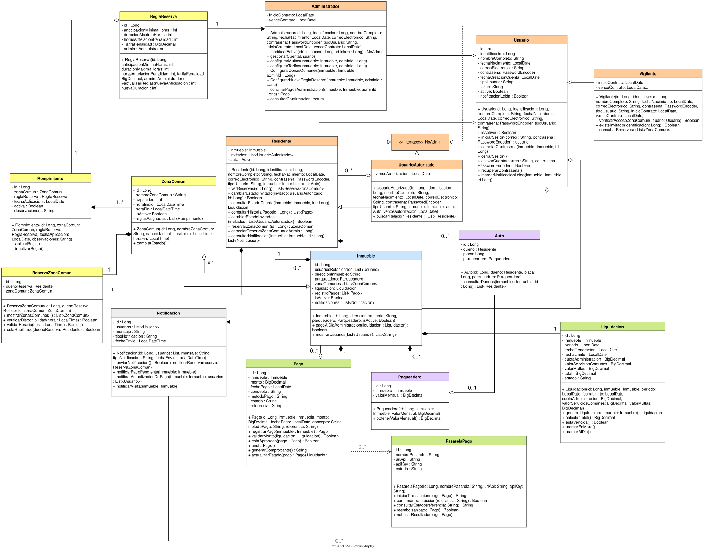

# HorizontalSoftware — Back-End

API REST para administrar un conjunto residencial en **propiedad horizontal** (Torres del Parque): cuotas de administración, pagos en línea con **Wompi**, reservas de zonas comunes, portería con invitados y notificaciones.

> **En una frase:** el administrador genera la cuota de cada inmueble, el residente la paga en línea y reserva zonas comunes, y el vigilante controla quién entra.

| | |
|---|---|
| **Stack** | Java 25 · Spring Boot 4 · Spring Security (OAuth2 Resource Server + JWT) · PostgreSQL 16 · Flyway |
| **Front que lo consume** | `software-residencial` (Next.js) |
| **Contrato de la API** | [`ENDPOINTS.md`](ENDPOINTS.md) |
| **Diagramas** | carpeta [`Diagramas/`](Diagramas) |

---

## Contenido

1. [Lo más importante](#1-lo-más-importante)
2. [Casos de uso (UML)](#2-casos-de-uso-uml)
3. [Modelo de clases (UML)](#3-modelo-de-clases-uml)
4. [Diagramas de secuencia](#4-diagramas-de-secuencia)
5. [Arquitectura y paquetes](#5-arquitectura-y-paquetes)
6. [Cómo correrlo](#6-cómo-correrlo)
7. [Configuración (.env)](#7-configuración-env)

---

## 1. Lo más importante

- **Tres roles con sesión:** `ADMINISTRADOR`, `RESIDENTE`, `VIGILANTE`. Los invitados existen como usuarios, pero **no inician sesión**. Cada endpoint declara su rol con `@PreAuthorize`.
- **Sesión con JWT:** `access_token` de 15 min y `refresh_token` de 7 días que **rota** en cada renovación. Si alguien reutiliza un refresh viejo, la sesión se anula.
- **El dinero lo decide el servidor:** el residente no envía el monto. El back calcula el saldo, firma el checkout de Wompi y solo aprueba el pago cuando el **webhook firmado** llega y la consulta directa a Wompi confirma estado, monto y moneda.
- **El `.env` es la única fuente de verdad** para la pasarela: al arrancar se valida, y si algo está mal el back no deja cobrar.
- **Base de datos versionada con Flyway** (`src/main/resources/db/migration`) y consultas en **SQL nativo**.
- **Una tarea nocturna** (`LiquidacionScheduler`) pasa a `EN_MORA` las liquidaciones vencidas.

### Qué puede hacer cada rol

| Rol | Puede |
|---|---|
| **Administrador** | Gestionar inmuebles, usuarios, zonas comunes y reglas de reserva · generar liquidaciones mensuales · conciliar pagos · enviar notificaciones |
| **Residente** | Ver su estado de cuenta · pagar en línea · reservar zonas comunes · registrar invitados y su auto · leer notificaciones |
| **Vigilante** | Verificar invitados y registrar su ingreso (el residente recibe el aviso) |

---

## 2. Casos de uso (UML)

Quién hace qué en el sistema, agrupado por módulo: actores y configuración base, pagos, zonas comunes, portería, comunicación, notificaciones y reportes.


> Fuente editable en draw.io: [`Diagramas/UML/Untitled Diagram.drawio.svg`](Diagramas/UML/Untitled%20Diagram.drawio.svg)

### De caso de uso a diagrama de secuencia

Cada caso de uso principal tiene su diagrama de secuencia, que muestra cómo lo resuelve el backend por dentro:

| Caso de uso | Actor | Diagrama de secuencia |
|---|---|---|
| Iniciar sesión | Todos | [4.1 Sesión con refresh token rotativo](#41-sesión-con-refresh-token-rotativo) |
| Realizar pagos | Residente | [4.2 Pago de administración con Wompi](#42-pago-de-administración-con-wompi) |
| Generar liquidación mensual | Administrador / Sistema | [4.3 Liquidaciones de administración](#43-liquidaciones-de-administración) |
| Reservar zona común | Residente | [4.4 Reservar una zona común](#44-reservar-una-zona-común) |
| Módulo de portería (ingreso de invitados) | Vigilante | [4.5 Ingreso de un invitado por portería](#45-ingreso-de-un-invitado-por-portería) |
| Configurar zonas comunes | Administrador | [4.7 Administrar zonas comunes](#47-administrar-zonas-comunes) |
| Enviar notificación · Consultar notificaciones | Administrador · Residente | [4.6 Notificaciones](#46-notificaciones) |

Los demás casos de uso (recuperar contraseña, cancelar reserva, conciliar pagos, incidencias, reportes…) no tienen diagrama de secuencia propio.

---

## 3. Modelo de clases (UML)

El dominio está en `src/main/java/unisimon/demo/model`. La idea central es que **todo gira alrededor del `Inmueble`** (residentes, parqueadero, liquidaciones, pagos y zonas comunes). `Administrador`, `Residente` y `Vigilante` heredan de `Usuario`, y el invitado (`UsuarioAutorizado`) es un tipo de residente que no inicia sesión.



> Fuente editable (draw.io): [`Diagramas/Clases/DiagramaClasesSoftwareHorizontal.xml`](Diagramas/Clases/DiagramaClasesSoftwareHorizontal.xml)

---

## 4. Diagramas de secuencia

Los flujos clave, de la petición a la base de datos. Para ver a qué caso de uso corresponde cada uno, mira la [tabla de la sección 2](#de-caso-de-uso-a-diagrama-de-secuencia). Cada imagen tiene su versión interactiva en `.html` en [`Diagramas/Secuencia/`](Diagramas/Secuencia) (descárgala y ábrela en el navegador para recorrer el flujo paso a paso).

**Leyenda:** verde = solicitud principal · rojo = paso de seguridad · punteado = respuesta o paso asíncrono.

### 4.1 Sesión con refresh token rotativo

Login, y cómo se renueva la sesión sin pedir la contraseña otra vez. Si alguien usa un refresh viejo, la huella no coincide y la sesión se anula (401).



### 4.2 Pago de administración con Wompi

El flujo más delicado del sistema: **el front nunca decide si un pago quedó aprobado**. El servidor fija el monto y firma el checkout. Cuando llega el webhook, verifica la firma, le pregunta a Wompi el estado real y solo aprueba si el monto y la moneda coinciden.



<details>
<summary>Ver la misma secuencia desde los servicios internos (<code>PagoService</code> / <code>PasarelaService</code>)</summary>


</details>

### 4.3 Liquidaciones de administración

Cómo nace la cuota mensual de un inmueble y cuándo pasa a mora, ya sea a mano o con la tarea nocturna.



### 4.4 Reservar una zona común

Antes de guardar la reserva se valida la fecha, que la zona esté habilitada, el horario, las reglas, el cupo y que no se cruce con otra reserva.


### 4.5 Ingreso de un invitado por portería



### 4.6 Notificaciones

El administrador envía un aviso (a usuarios puntuales, a los residentes de un inmueble o a todos) y el residente lo lista y lo marca como leído.


### 4.7 Administrar zonas comunes

El administrador crea zonas, las lista (con caché) y las activa o inactiva. Cada cambio limpia la caché.



---

## 5. Arquitectura y paquetes

Arquitectura por capas: **Controller → Service → Repository → PostgreSQL**, con Spring Security delante de todo y Wompi como servicio externo.



<details>
<summary>Ver la versión v1 de la arquitectura</summary>


</details>

### Paquetes



| Paquete (`unisimon.demo`) | Para qué es |
|---|---|
| `controller` | Endpoints REST, uno por rol/recurso (`Admin*`, `Residente*`, `Vigilante*`, `Auth`, `PasarelaWebhook`) |
| `service` / `service/impl` | Reglas de negocio (interfaces + implementaciones) |
| `repository` | Acceso a datos con SQL nativo |
| `model` | Clases del dominio |
| `dto/request`, `dto/response`, `mapper` | Lo que entra y sale de la API, y la conversión desde el modelo |
| `security` | Emisión/lectura de JWT, roles y anotaciones de acceso |
| `policy`, `factory` | Reglas reutilizables y creación de objetos |
| `integration/wompi` | Cliente de la pasarela de pagos |
| `scheduler` | Tareas programadas (mora de liquidaciones) |
| `exception` | Manejo uniforme de errores (404, 405, 409…) |
| `bootstrap` | Datos iniciales (admin semilla, sincronizar pasarela con el `.env`) |

> Fuentes: [`Arquitectura/*.html`](Diagramas/Arquitectura) (interactivos) · [`Paquetes/paquetes-backend.xml`](Diagramas/Paquetes/paquetes-backend.xml) (draw.io)

### Cómo regenerar las imágenes

Los `.svg` son exportaciones de las fuentes. Si cambias un diagrama, vuelve a exportarlo para que el README no quede desactualizado:

- **Secuencia y arquitectura** (`.html` de archify): abre el `.html` → botón **Export** → **SVG en tema claro** (light), y guárdalo con el mismo nombre al lado.
- **Clases y paquetes** (`.xml` de draw.io): ábrelo en [app.diagrams.net](https://app.diagrams.net) → **Archivo → Exportar como → SVG**, y guárdalo con el mismo nombre al lado.

---

## 6. Cómo correrlo

**Requisitos:** JDK 25 y Docker.

```bash
# 1. Configura las variables
cp .env.example .env

# 2. Arranca (Spring levanta Postgres solo con docker compose)
./mvnw spring-boot:run
```

La API queda en `http://localhost:8080` y todas las rutas empiezan por `/api`. Al arrancar, Flyway crea las tablas y se crea un administrador semilla (`SEED_ADMIN_*` en el `.env`).

**Pruebas:**

```bash
./mvnw test
```

**Todo en contenedores (API + Postgres):**

```bash
./mvnw clean package
docker compose up --build
```

> Usa `postgres:16-alpine`, no `postgres:latest`: la v18 cambió la ruta de datos y rompe el volumen.

---

## 7. Configuración (.env)

Copia [`.env.example`](.env.example) a `.env`. El `.env` **no se sube a git**.

| Variable | Para qué |
|---|---|
| `DB_NAME`, `DB_USER`, `DB_PASSWORD` (`DB_URL` opcional) | Conexión a PostgreSQL |
| `DB_POOL_MIN`, `DB_POOL_MAX` | Tamaño del pool de conexiones |
| `JWT_SECRET` | Llave que firma los JWT (mínimo 32 caracteres) |
| `CORS_ALLOWED_ORIGINS` | Origen del front (por defecto `http://localhost:3000`) |
| `SEED_ENABLED`, `SEED_ADMIN_*` | Administrador inicial (`false` en producción) |
| `PASARELA_API_KEY` | Llave pública de Wompi: abre el checkout |
| `PASARELA_INTEGRITY_SECRET` | Firma el checkout |
| `PASARELA_EVENTS_SECRET` | Verifica la firma del webhook |
| `PASARELA_PRIVATE_KEY` | Consulta la transacción en Wompi antes de aprobar |
| `PASARELA_URL_API_REST` | `https://sandbox.wompi.co/v1` (pruebas) o `https://production.wompi.co/v1` |
| `PASARELA_REDIRECT_URL` | Pantalla del front a la que vuelve el residente (opcional) |

> Las cuatro llaves de Wompi y la URL REST deben ser **del mismo ambiente** (pruebas o producción). Si no, el back lo detecta al arrancar y no deja cobrar.

---

Para el detalle de cada endpoint (rutas, cuerpos, respuestas y errores) ve a **[`ENDPOINTS.md`](ENDPOINTS.md)**.
