# HorizontalSoftware — Back-End

API REST para un conjunto residencial en propiedad horizontal (Torres del Parque): cuotas de administración, pagos en línea con **Wompi**, reservas de zonas comunes, portería con invitados y notificaciones.

**Stack:** Java 25 · Spring Boot 4 · Spring Security (JWT) · PostgreSQL 16 + Flyway · Docker

El detalle de cada endpoint está en [`ENDPOINTS.md`](ENDPOINTS.md). Lo consume el front `software-residencial` (Next.js).

## Inicio rápido

```bash
cp .env.example .env     # completa las variables
./mvnw spring-boot:run   # levanta Postgres con docker compose; API en http://localhost:8080/api
./mvnw test              # pruebas
```

Al arrancar, Flyway crea las tablas y se crea un administrador semilla (`SEED_ADMIN_*`).

## Lo importante

- **Roles:** `ADMINISTRADOR`, `RESIDENTE` y `VIGILANTE`; los invitados no inician sesión. Cada endpoint declara su rol con `@PreAuthorize`.
- **Sesión:** access token de 15 min y refresh de 7 días que rota; reutilizar uno viejo anula la sesión.
- **Pagos:** el servidor fija el monto y solo aprueba con el webhook firmado de Wompi y una consulta directa que confirme estado, monto y moneda.
- **Mora:** una tarea nocturna pasa a `EN_MORA` las liquidaciones vencidas.

| Rol | Puede |
|---|---|
| Administrador | Inmuebles, usuarios, zonas comunes, liquidaciones, conciliar pagos y notificaciones |
| Residente | Estado de cuenta, pagar en línea, reservar zonas, registrar invitados y leer notificaciones |
| Vigilante | Verificar invitados y registrar su ingreso |

## Diagramas

### Casos de uso


### Clases


### Componentes

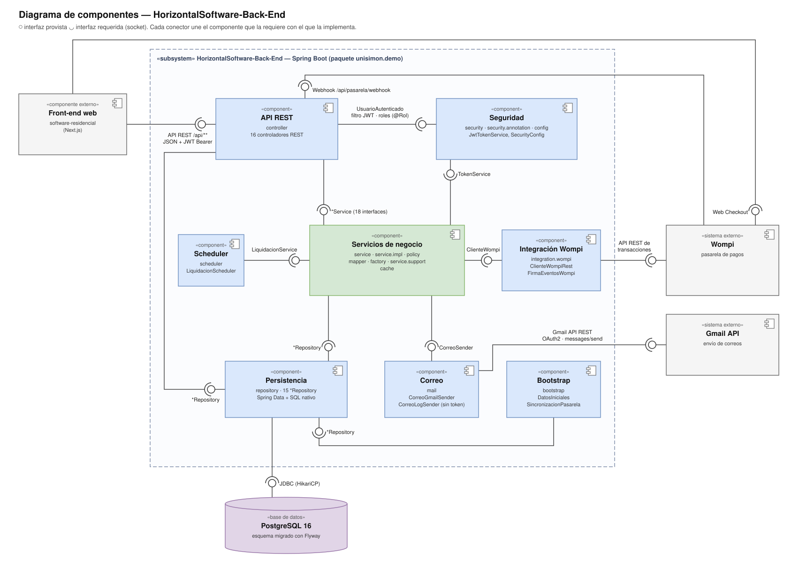

### Paquetes

<details>
<summary><b>Para qué es cada paquete</b></summary>

| Paquete (`unisimon.demo`) | Para qué es |
|---|---|
| `controller` | Endpoints REST por rol y recurso |
| `scheduler` | Tareas programadas (mora) |
| `config` | Seguridad, CORS y cache |
| `security` | JWT, usuario autenticado y anotaciones de rol |
| `service` / `service/impl` / `service/support` | Reglas de negocio |
| `policy`, `factory` | Reglas de estado y acceso, creación de usuarios |
| `mapper` | Vistas SQL a objetos de respuesta |
| `cache` | Nombres de las caches |
| `integration/wompi` | Cliente de Wompi |
| `mail` | Correo (por ahora al log) |
| `bootstrap` | Admin semilla y pasarela desde el `.env` |
| `repository` | SQL nativo con Spring Data |
| `model` | Dominio |
| `dto/request`, `dto/response` | Entrada y salida de la API |
| `exception` | Errores uniformes |

</details>

### Diagramas de secuencia

Un diagrama por caso de uso: los participantes son clases del diagrama de clases y los mensajes son sus operaciones, con los nombres y parámetros del diagrama. Se generan con `Diagramas/_fuente/gen_secuencia_casos_uso.py`.

<details>
<summary><b>Cuenta y sesión</b> (6)</summary>

**Iniciar sesión**


**Activar cuenta creada**


**Recuperar contraseña**

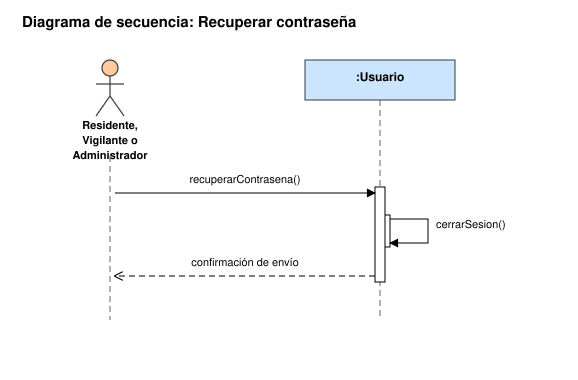

**Cambiar contraseña**


**Gestionar cuentas de usuario**


**Configurar preferencias de notificación**

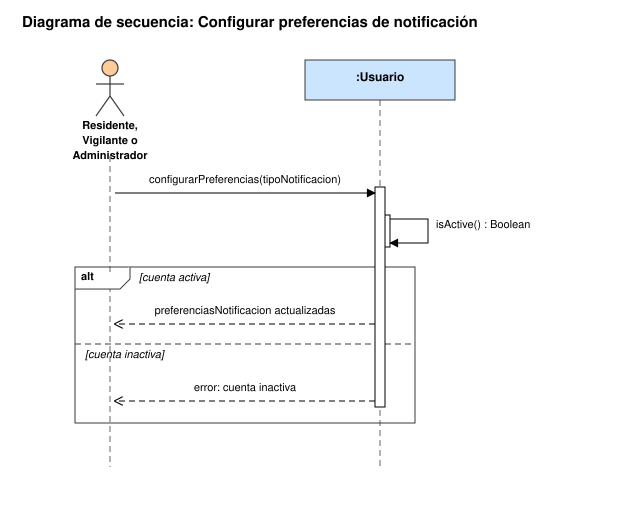

</details>

<details>
<summary><b>Configuración del conjunto</b> (4)</summary>

**Configurar multas**


**Configurar tarifas**


**Configurar zonas comunes**


**Configurar reglas de reserva**


</details>

<details>
<summary><b>Pagos y liquidaciones</b> (5)</summary>

**Consultar estado de cuenta e historial de pagos**

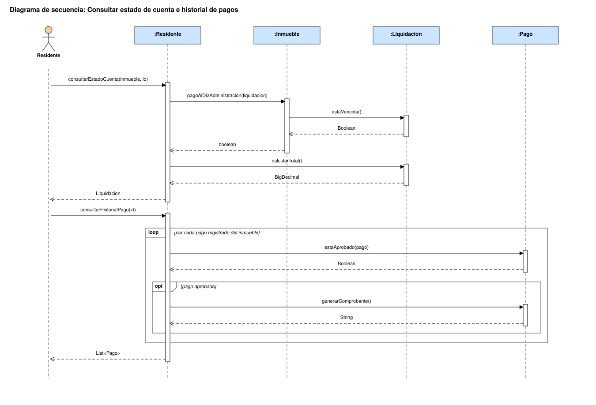

**Realizar pagos**


**Conciliar pagos de administración**


**Generar liquidación mensual**


**Reembolsar pago**


</details>

<details>
<summary><b>Comunicados y notificaciones</b> (7)</summary>

**Consultar comunicado oficial**


**Publicar comunicado oficial**


**Consultar confirmación de lectura**


**Consultar notificaciones**


**Enviar notificación**


**Enviar notificaciones de vencimiento y mora**


**Enviar recordatorio de reserva próxima**

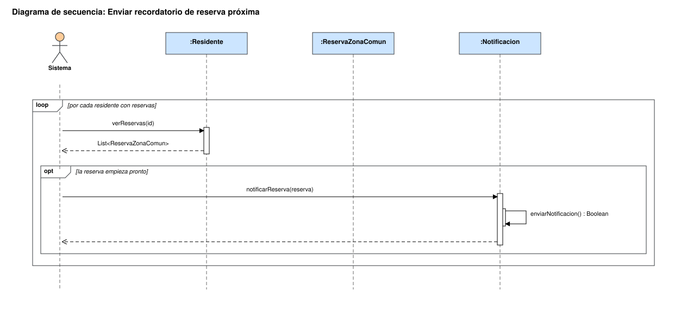

</details>

<details>
<summary><b>Zonas comunes y reservas</b> (4)</summary>

**Consultar calendario de disponibilidad**


**Reservar zona común**


**Cancelar reserva**


**Verificar acceso a zona común**


</details>

<details>
<summary><b>Portería, incidencias y reportes</b> (6)</summary>

**Consultar dueño del carro**


**Consultar relacionados al inmueble**


**Consultar parqueaderos**


**Registrar incidencia operativa**


**Consultar incidencias operativas**


**Generar reportes consolidados**

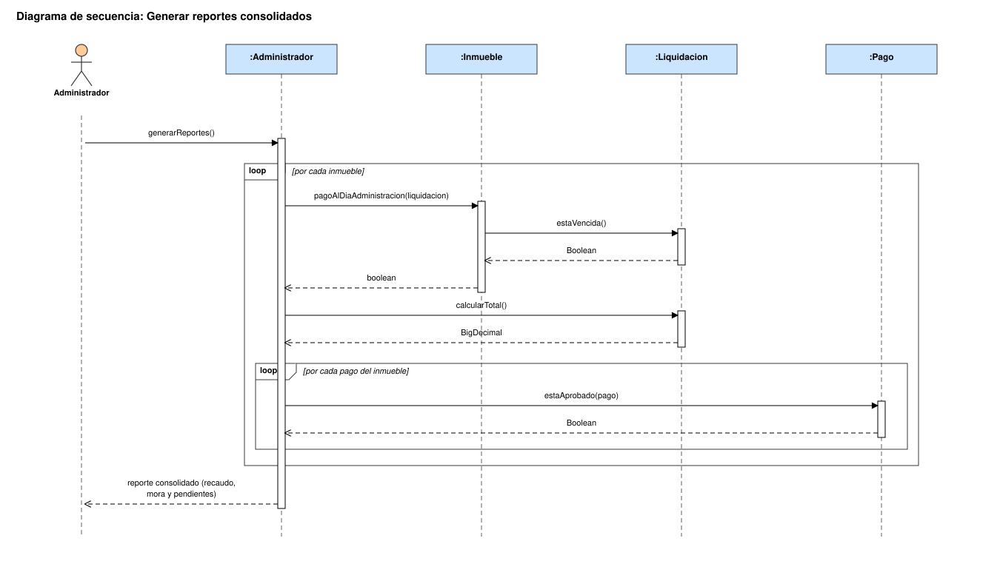

</details>

## Configuración (.env)

| Variable | Uso |
|---|---|
| `DB_NAME`, `DB_USER`, `DB_PASSWORD` (`DB_URL`), `DB_POOL_MIN`, `DB_POOL_MAX` | PostgreSQL |
| `JWT_SECRET` | Firma de los JWT (≥ 32 caracteres) |
| `CORS_ALLOWED_ORIGINS` | Origen del front |
| `SEED_ENABLED`, `SEED_ADMIN_*` | Administrador inicial (`false` en producción) |
| `PASARELA_API_KEY`, `PASARELA_INTEGRITY_SECRET`, `PASARELA_EVENTS_SECRET`, `PASARELA_PRIVATE_KEY` | Llaves de Wompi |
| `PASARELA_URL_API_REST`, `PASARELA_REDIRECT_URL` | API de Wompi (sandbox o producción) y retorno al front |

Las llaves y la URL de Wompi deben ser del mismo ambiente; si no, el back no deja cobrar.

<details>
<summary>Todo en contenedores (API + Postgres)</summary>

```bash
./mvnw clean package
docker compose up --build
```

Usa `postgres:16-alpine`: la v18 cambió la ruta de datos y rompe el volumen.

</details>

<details>
<summary>Editar los diagramas</summary>

- **Secuencia:** se generan con `python Diagramas/_fuente/gen_secuencia_casos_uso.py`, que escribe el `.xml` en [`Diagramas/_fuente`](Diagramas/_fuente) y un `.svg` por diagrama en `Diagramas/Secuencia`.
- **Casos de uso, clases y componentes:** abre el `.xml` / `.drawio.svg` en [draw.io](https://app.diagrams.net) → **Archivo → Exportar como → SVG**.
- **Fondo claro:** draw.io exporta SVG que se ven oscuros en modo oscuro. `python Diagramas/_fuente/fondo_claro.py` los deja siempre claros; el hook `scripts/hooks/pre-commit` lo corre solo al commitear (se activa una vez con `git config core.hooksPath scripts/hooks`).

</details>
